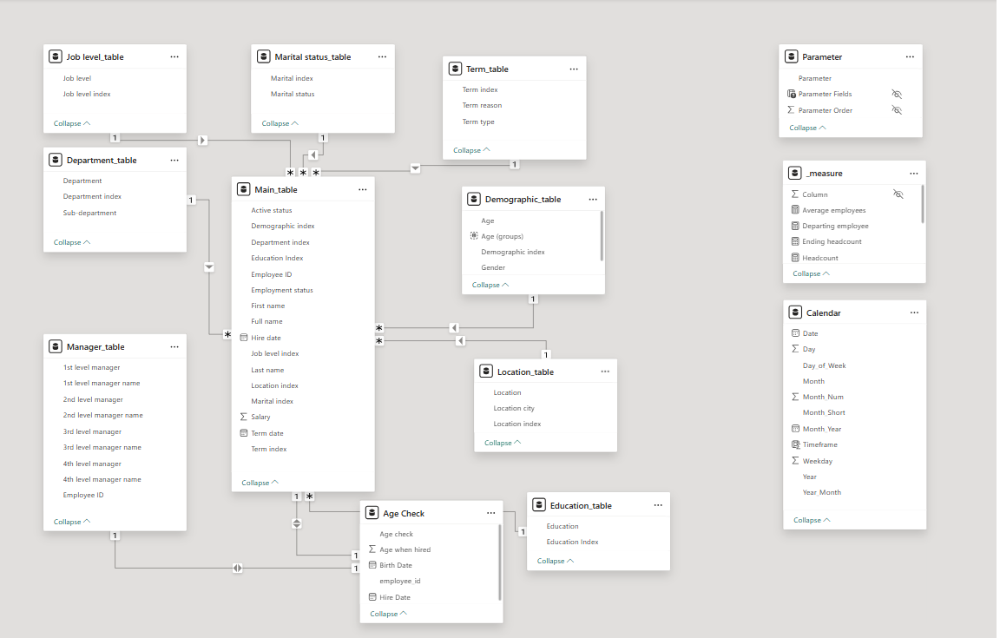
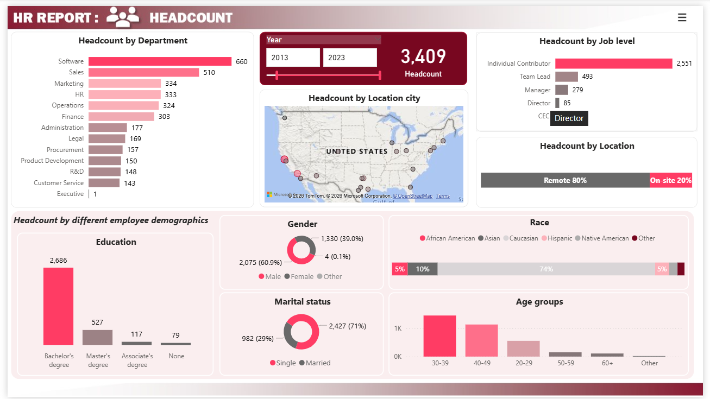
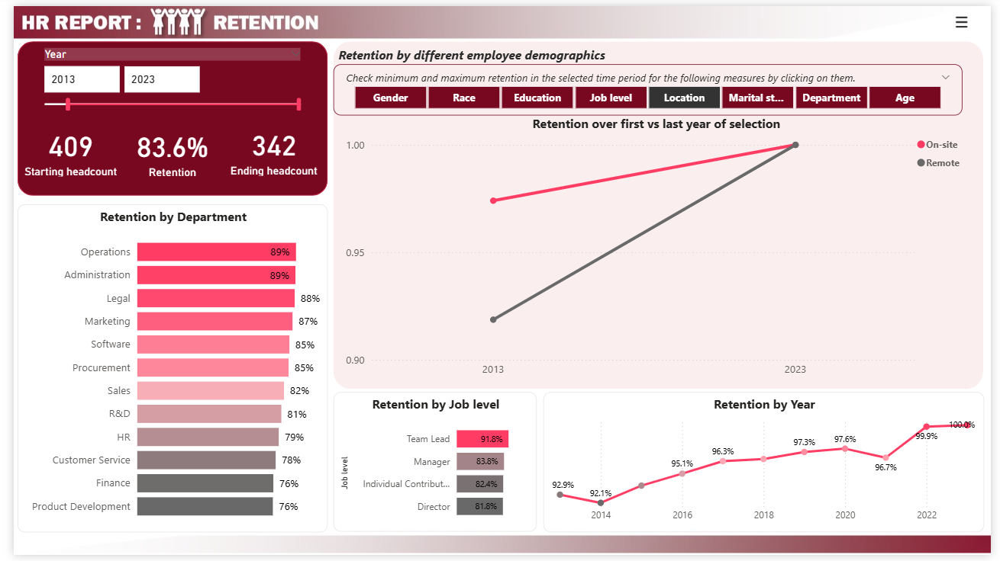
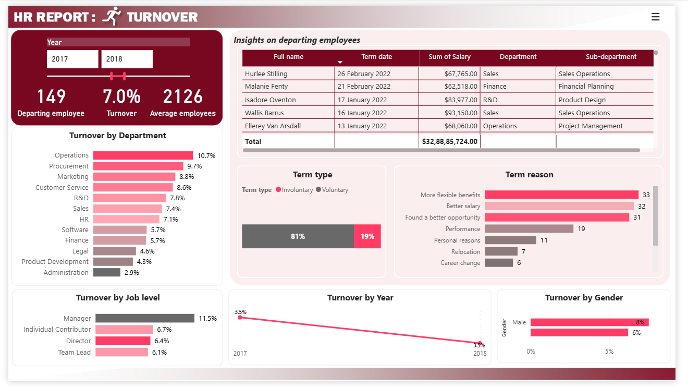

# HR Workforce Analytics: Headcount, Retention and Turnover (Power BI)

It is an interactive Power BI report that gives an HR team one place to see **who works in the company, how many employees they have, and why employees leave**. It is built on two raw HR files for an imaginary company of 4,138 employees (2012-2022).

> **Project type:** This is a guided project. I followed a structured course to build the dashboard in Power BI, and I added my own data-quality checks, my own validation steps, and documentation and further analysis. See [What I added](#2-project-transparency-what-is-guided-and-what-i-added).

---

## Table of contents

1. [Project at a glance](#1-project-at-a-glance)
2. [Project transparency: what is guided and what I added](#2-project-transparency-what-is-guided-and-what-i-added)
3. [Business problem and objectives](#3-business-problem-and-objectives)
4. [Data source and data dictionary](#4-data-source-and-data-dictionary)
5. [Data preparation in Power Query](#5-data-preparation-in-power-query)
6. [Data quality finding: implausible age at hire](#6-data-quality-finding-implausible-age-at-hire)
7. [Data model](#7-data-model)
8. [DAX measures](#8-dax-measures)
9. [Dashboard walkthrough](#9-dashboard-walkthrough)
10. [Key insights](#10-key-insights)
11. [Recommendations](#11-recommendations)
12. [Limitations and assumptions](#12-limitations-and-assumptions)
13. [How to use this project](#13-how-to-use-this-project)
14. [Skills demonstrated](#14-skills-demonstrated)
15. [Future improvements](#15-future-improvements)
16. [About me](#17-about-me)

---

## 1. Project at a glance

| Item | Detail |
|---|---|
| **Domain** | Human resources / people analytics |
| **Business scenario** | HR leadership at an imaginary company needs a single view of headcount, retention and turnover |
| **Data** | 2 CSV files, 4,138 employees, 13 departments, hires from 2012 to 2021, exits from 2012 to February 2022 |
| **Current employees / leavers** | 3,409 current employees, 729 leavers |
| **Tools** | Power BI Desktop, Power Query (M), DAX |
| **Report pages** | Cover page with navigation, Headcount, Retention, Turnover |
| **Model** | 1 central employee table, 8 supporting tables (dimensions and a manager table), a measures table, and a date table |
| **Status** | Built in Power BI Desktop with a personal account. It is not published to Power BI Service, so screenshots and the `.pbix` file are provided instead. |

---

## 2. Project transparency: what is guided and what I added

**Guided parts.** I built the core report by following a step-by-step course. That covers the overall report structure (Headcount, Retention, Turnover), the dimensional modelling approach, and the headcount, retention and turnover measure logic. I carried out every step myself in Power Query and Power BI Desktop.

**What I added myself:**

- **Age-at-hire data-quality check.** I merged birth dates into the employment table, calculated the age of each employee on their hire date, and found 451 employees (10.9%) who were hired before age 18. I flagged them with an `Age check` column rather than deleting them. See [section 6](#6-data-quality-finding-implausible-age-at-hire).
- **Validation of the dimension tables.** I checked each dimension table's row count and join after building it.
- **Measure validation.** I tested all the measures. For eg. Headcount measure on 2012: 419 employees were hired and 10 left, which leaves 409.
- **Documentation and insights.** I wrote the data dictionary, the preparation log, the measure explanations, the insights and the limitations in this README, and I checked the figures against the source data.

---

## 3. Business problem and objectives

### Business scenario

An imaginary company has employee records spread across two flat files. HR leadership can't easily answer basic workforce questions: how many people work here and where, how many do we keep each year, who is leaving, and why. Without that view it is hard to spot departments with high attrition or to decide where retention effort should go.

### Objectives

1. Show the **size and make-up of the workforce** by department, job level, location and demographics.
2. Measure **retention** by year and by department.
3. Measure **turnover** and break it down by type (voluntary or involuntary) and reason.
4. Let a non-technical user filter the data and explore it without help.

### Business questions the report answers

| Question | Page |
|---|---|
| How many employees do we have, and how are they spread across departments and job levels? | Headcount |
| What does the workforce look like by gender, age group, education, race and work location? | Headcount |
| What share of employees stay for a full year, and how has that changed since 2012? | Retention |
| Which departments keep the fewest or the most of their people? | Retention |
| How many people leave each year, and which departments lose the most? | Turnover |
| Are exits voluntary or involuntary, and what reasons do leavers give? | Turnover |

---

## 4. Data source and data dictionary

The dataset describes an imaginary company, so the figures illustrate analytical technique and aren't real HR conclusions.

### File 1: employee table (one row per employee)

| Column | Description |
|---|---|
| `employee_id` | Unique employee ID (join key) |
| `gender` | Employee gender |
| `race` | Employee race |
| `birth_date` | Date of birth (stored as text, M/D/YYYY) |
| `education` | Highest education level (98 blank values) |
| `location` | Remote or On-site |
| `location_city` | City of the work location |
| `marital_status` | Marital status |
| `employment_status` | Employment type (for example full time or contract) |

### File 2: employment table (one row per employee)

| Column | Description |
|---|---|
| `employee_id` | Unique employee ID (join key) |
| `first_name`, `last_name` | Employee name |
| `department`, `sub-department` | Organisational unit |
| `first_level_manager` to `fourth_level_manager` | Employee IDs of the four management levels above the employee |
| `job_level` | Individual Contributor, Team Lead, Manager, Director or CEO |
| `salary` | Annual salary |
| `hire_date` | Date joined (stored as text) |
| `term_date` | Date left (blank for current employees) |
| `term_type` | Voluntary or Involuntary |
| `term_reason` | Reason given for leaving |
| `active_status` | 1 if still employed, 0 if left |

### Data profile

| Check | Result |
|---|---|
| Employees | 4,138 |
| Departments | 13 (including a single Executive record) |
| Hire dates | 1 Jan 2012 to 31 Dec 2021 |
| Exit dates | 4 Nov 2012 to 26 Feb 2022 |
| Current employees / leavers | 3,409 / 729 |
| Share of exits that are voluntary | 82.2% |
| Duplicate rows | 0 |

---

## 5. Data preparation in Power Query

The raw files were already fairly clean (no duplicates and almost no nulls), so most of the work was **reshaping them into a dimensional model** rather than fixing errors. The steps are below.

### Step log

| # | Query | Action | Result |
|---|---|---|---|
| 1 | Employee table | Replaced `active_status` values 1 and 0 with Yes and No | Readable status values |
| 2 | Employee table | Converted `birth_date` from text to date and calculated age from it | Age column (see the note below) |
| 3 | Employment table | Changed the four manager ID columns to text | Types match for the manager merges |
| 4 | Employment and Employee tables | Merged on employee ID and expanded the employee columns | One table of 4,138 rows with every attribute |
| 5 | Department table | Kept department and sub-department, removed duplicates, added `Department index` | **37** rows instead of 4,138 |
| 6 | Job level table | Distinct job levels with `Job level index` | **5** rows |
| 7 | Term table | Distinct term type and reason pairs with `Term index` | **10** rows. Employees still working have a blank `Term index`. |
| 8 | Demographic table | Distinct gender, race and age combinations with `Demographic index` | **393** rows |
| 9 | Education table | Distinct education values with `Education index`. Blank records were replaced with "None". | **4** rows (3 education levels plus "None") |
| 10 | Location table | Distinct location and city pairs with `Location index` | **23** rows |
| 11 | Marital status table | Distinct values with `Marital index` | **2** rows |
| 12 | Manager table | Merged each manager level back to the employee table to get the manager's first and last name, then combined them into a full name per level | Manager table with ID and full name for four management levels, linked through employee ID |
| 13 | Employment table | Merged each dimension's index into the employment table, then removed the original descriptive columns | Compact central table (see below) |
| 14 | Age check table | All the employees hire and birth dates to check the age of people when they were hired | **4138** rows |

I merged the employee data into the employment table first so that every dimension could be created from a single table, which also gave me **one central table with one row per employee** to build the model around.

### Final central table (`Main_table`)

`Employee ID`, `First name`, `Last name`, `Salary`, `Hire date`, `Term date`, `Active status`, `Employment status`, `Job level index`, `Department index`, `Demographic index`, `Education index`, `Location index`, `Marital index`, `Term index`.

### Notes on specific choices

- **Age.** Age was calculated against the date of refresh, so it is "age as of today", not age at the time of the events in the data. It is used for the age-group breakdowns on the Headcount page only.
- **Education "None".** This stands for a *missing education record* (98 employees, about 2.4% of all employees), not for a person with no education.
- **Blank `Term index`.** Current employees have no exit, so their term index is blank by design.

### Validation

- Merging the two source files kept **4,138 rows** with none lost or duplicated.
- Each dimension table's row count and join were checked after it was created.
- The Headcount measure was tested on 2012 against hand-calculated figures (see [section 8](#8-dax-measures)).

---

## 6. Data quality finding: implausible age at hire

Because the report covers events from 2012 onward, I checked how old each employee was **on their hire date**, not just how old they are today.

**Method.** I referenced the employee table, got the birth date and merged main_table and got the hire date into the new age check table and added a custom column:

```
Age when hired = Number.RoundDown( Duration.Days( [Hire Date] - [Birth Date] ) / 365.25 )
```

Dividing by 365.25 accounts for leap years, and rounding down gives completed years. Before calculating, I confirmed both date columns were typed as dates.

**Finding.** **451 employees (10.9%) were hired before age 18.** That is implausible for a real company and is most likely an artefact of how the synthetic data was generated.

**Decision.** I added an `Age check` column to flag these rows and **kept them in the model**. Removing them would change headcount, retention and turnover for every year, and I have no way to correct the dates. In a real project I would raise this with the data owner.

Age measured against today's date hides this problem, because everyone looks like an adult.

---

## 7. Data model



### Structure

The model is a **star-style schema** built around one employee-level table.

| Table | Role |
|---|---|
| `Main_table` | Central table, one row per employee (4,138 rows) |
| `Department_table` | Department and sub-department |
| `Job level_table` | Job level |
| `Education_table` | Education level |
| `Location_table` | Location and city |
| `Marital status_table` | Marital status |
| `Demographic_table` | Gender, race, age and age group |
| `Term_table` | Exit type and reason |
| `Manager_table` | Names of the four management levels, linked through employee ID |
| `_measure` | Holds all DAX measures |
| `Calendar` | Calendar used by the headcount, retention and turnover measures |
| `Parameter` | Field parameter used on the Retention page |
| `Age Check` | To check whether the age of employees was valid when they were hired |


### Relationships

- Each dimension table connects to `Main_table` through its index column in a **one-to-many** relationship (one on the dimension side).
- `Manager_table` connects to `Main_table` on employee ID.
- `Calendar` is deliberately **not related** to `Main_table`. The employee table has two relevant dates (hire and exit), and a single relationship can't serve both. Instead, the measures compare each employee's hire and term dates against the first and last date of whichever period is in view.

### Why a calendar table

The employee table only has dates on days when something happened: a hire, or an exit. Headcount and retention need a value for **every** year or month, including periods where nobody joined or left. The calendar table supplies that continuous list of dates, and the measures evaluate each period against it.

### The Timeframe filter

A `Timeframe` column on the calendar flags dates from the first hire date up to today:

```DAX
Timeframe = IF('Calendar'[Date] >= FIRSTDATE(Main_table[Hire date])
            && 'Calendar'[Date] <= TODAY(), 1, 0)
```

It is applied as a **report-level filter (Timeframe = 1)** so that every page and slicer uses the same date range and unused calendar dates don't appear. Because it ends at `TODAY()`, years after the data ends contain no exits (see [limitations](#12-limitations-and-assumptions)).

---

## 8. DAX measures

All measures live in the `_measure` table.

### Core definitions

```DAX
Total employees = DISTINCTCOUNT ( Main_table[Employee ID] )

Headcount =
CALCULATE (
    [Total employees],
    FILTER (
        Main_table,
        Main_table[Hire date] <= LASTDATE ( 'Calendar'[Date] )
            && ( Main_table[Term date] > LASTDATE ( 'Calendar'[Date] )
                 || Main_table[Term date] = BLANK () )
    )
)

Starting headcount =
CALCULATE (
    [Total employees],
    FILTER (
        Main_table,
        Main_table[Hire date] < FIRSTDATE ( 'Calendar'[Date] )
            && ( Main_table[Term date] = BLANK ()
                 || Main_table[Term date] >= FIRSTDATE ( 'Calendar'[Date] ) )
    )
)

Ending headcount =
CALCULATE (
    [Total employees],
    FILTER (
        Main_table,
        Main_table[Hire date] < FIRSTDATE ( 'Calendar'[Date] )
            && ( Main_table[Term date] = BLANK ()
                 || Main_table[Term date] >= LASTDATE ( 'Calendar'[Date] ) )
    )
)

Departing employee =
CALCULATE (
    [Total employees],
    FILTER (
        Main_table,
        Main_table[Term date] >= FIRSTDATE ( 'Calendar'[Date] )
            && Main_table[Term date] <= LASTDATE ( 'Calendar'[Date] )
    )
)

Average employees = ( [Starting headcount] + [Headcount] ) / 2

Retention = [Ending headcount] / [Starting headcount]

Turnover = [Departing employee] / [Average employees]

Min Max retention =
SWITCH (
    TRUE (),
    SELECTEDVALUE ( 'Calendar'[Year] )
        = CALCULATE ( MIN ( 'Calendar'[Year] ), ALLSELECTED ( 'Calendar' ) ), [Retention],
    SELECTEDVALUE ( 'Calendar'[Year] )
        = CALCULATE ( MAX ( 'Calendar'[Year] ), ALLSELECTED ( 'Calendar' ) ), [Retention],
    BLANK ()
)
```

### What each measure means

| Measure | Plain-language meaning |
|---|---|
| **Total employees** | Number of distinct employee IDs in the current filter context |
| **Headcount** | Employees hired on or before the last day of the period who had not left by then. This includes people hired during the period. |
| **Starting headcount** | Employees already at the company on the first day of the period (hired before it, and not yet gone) |
| **Ending headcount** | Employees from the **starting group** who are still with the company at the end of the period. People hired during the period are excluded. |
| **Departing employee** | Employees whose exit date falls inside the period |
| **Average employees** | The mean of starting headcount and end-of-period headcount |
| **Retention** | Ending headcount ÷ starting headcount: the share of the starting group that stayed |
| **Turnover** | Departing employees ÷ average employees |
| **Min Max retention** | Retention shown only for the first and last year in the current selection, used for a benchmark chart on the Retention page |

### Design notes

- **Why new hires are excluded from retention.** Retention asks how many existing employees the company kept. Someone hired during the year has not yet been there a full period, and including them in the numerator but not the denominator would let retention exceed 100%. That is why `Ending headcount` is built on the starting group.
- **Boundary day.** `Ending headcount` uses `Term date >= last day` and `Departing employee` uses `Term date <= last day`, so an employee who leaves exactly on the last day of the period is counted in both. It affects very few rows.
- **Validation.** For 2012, Headcount returned 409: 419 employees were hired and 10 left.

---

## 9. Dashboard walkthrough

### Cover page

A landing page with navigation buttons to the three analysis pages.


### Page 1: Headcount

**Purpose:** show how many people work in the company and what the workforce looks like.
Breakdowns include department, job level, work location, education, gender, race, marital status and age group.



### Page 2: Retention

**Purpose:** show how well the company keeps its people over time and by department.
Includes retention by year, by department and by job level, plus a min and max retention benchmark that uses a field parameter.



### Page 3: Turnover

**Purpose:** show how many people leave and why.
Includes turnover and departures by year and department, voluntary versus involuntary exits, and exit reasons.



### Interactivity

- **Slicers** for age, department, sub-department, education, job level, location, location city, marital status and year, grouped in a **collapsible filter panel** controlled by bookmarks
- **Navigation buttons** between pages
- **Field parameter** on the all pages to switch the view

---

## 10. Key insights

> **Scope:** hires run from 2012 to 2021 and exits end in February 2022. Years after that contain no exits, so retention for those years isn't meaningful. Headcount figures describe the 3,409 current employees. The insights describe an imaginary company.

### Headcount

| Observation | So what |
|---|---|
| **Software (660) and Sales (510)** are the largest departments, followed by Marketing (334) and HR (333). Customer Service (143) is the smallest after the single Executive. | Software and Sales together hold **34.3%** of current employees, so their hiring and exit patterns move company-wide numbers more than any other department. |
| **Education:** 78.8% hold a Bachelor's degree, 15.5% a Master's and 3.4% an Associate's. 2.3% (79 employees) have no education record. | The workforce is highly graduate-qualified. The missing records are concentrated in HR (19.0%) and Software (16.5%), which suggests an HR data-entry gap to fix. |
| **Gender:** 60.9% male, 39.0% female. No department has more women than men. Customer Service is closest, with 70 women and 73 men. | Exit rates are almost equal for women (17.9%) and men (17.5%), so the imbalance comes from **who is hired**, not from who leaves. Hiring would be the place to look. |
| **Age:** the 30s are the largest group (42.3%), measured as of the refresh date. | The company is built around mid-career staff. |
| **Work location:** 79.9% of employees work remotely. | Location does not explain attrition: on-site staff (18.1%) and remote staff (17.5%) leave at nearly the same rate. |
| **Race:** 74.3% of employees are Caucasian, followed by Asian (10.2%). | Representation is concentrated in one group, which matters if diversity is a company goal. |
| **Leadership:** the single Executive record, the CEO, was hired in 2017. | Executive-level data is too thin for any analysis. |

### Retention

| Observation | So what |
|---|---|
| Company retention **rose steadily from [2016 value] in 2016 to 97.8% in 2020**. | Retention improved year over year across the period, which suggests the company has become better at keeping people. |
| **Exits jumped from 89 in 2020 to 168 in 2021**, lowering retention. Of the 168, 145 were voluntary, and the top reasons were more flexible benefits (45) and better salary (42). In 2020, "found a better opportunity" led. | Pay and benefits drove the 2021 spike, not a general loss of engagement. Sales (32), Software (24) and Operations (20) lost the most people. |
| **R&D** recorded among the lowest retention rates in 2013 and 2016. Its leavers cited more flexible benefits (10), a better opportunity (9) and better salary (7). R&D also has the highest exit rate of any department (20.9% of everyone ever hired there). | Benefits and pay are the first things to review in R&D. The group is small (about 40 exits), so this is a signal to investigate. |
| **Administration** leavers mainly cited better salary (10) and more flexible benefits (9). Only 5 of 31 leavers were managers. | Attrition there is mostly among individual contributors, not leadership. |

### Turnover

| Observation | So what |
|---|---|
| **About 82% of exits are voluntary**. The top reasons are a better opportunity (179), more flexible benefits (178) and better salary (150). | Voluntary exits are the ones a company can influence, and all three top reasons relate to what the company offers. That is where retention effort would pay off most. |
| The **median leaver left after about 1 year**. | Attrition is concentrated early in tenure, which points to onboarding and the first-year experience. This describes leavers only. |

---

## 11. Recommendations

The company is imaginary, so these are the actions I would suggest in a real setting and should be treated as hypotheses to test, not proven causes.

1. **Review pay and benefits in the departments with the most exits** (Sales, Software, R&D). Voluntary leavers consistently cite better salary and more flexible benefits.
2. **Strengthen onboarding and first-year support.** Half of leavers go within about a year of joining.
3. **Look at the hiring pipeline for gender balance.** Exit rates are equal, so the imbalance is a hiring effect.
4. **Collect exit-interview detail.** The reason field is coarse, and more specific data would show what "flexible benefits" means in practice.
5. **Fix the education data gap** in HR and Software so profile analysis is complete.
6. **Track retention for small departments with care.** A few exits can swing the percentage, so show the headcount alongside the rate.

---

## 12. Limitations and assumptions

- **Synthetic data.** The dataset describes an imaginary company, so the insights illustrate method and aren't real HR findings.
- **Implausible ages at hire.** 451 employees (10.9%) were hired before age 18. They are flagged and kept (see [section 6](#6-data-quality-finding-implausible-age-at-hire)).
- **Age is measured as of the refresh date,** not at the time of each event in the data.
- **Data ends in early 2022.** Exits run to February 2022, but the `Timeframe` filter ends at `TODAY()`. Retention in later years shows close to 100% only because nobody left, and shouldn't be interpreted.
- **Small groups.** Some departments and sub-departments are small, so their retention percentages can swing widely on a few exits.
- **Retention is annual and cohort-based.** It measures how many people present on the first day of a period were still there on the last day.
- **Boundary day.** An employee who leaves on the last day of a period is counted as both retained and departed.
- **No engagement or satisfaction data.** The dataset has no survey, performance or engagement fields, so the report can describe who leaves and the reasons they gave, but not measure satisfaction.
- **Not published.** The report was built with a personal Power BI Desktop account, so it isn't hosted on Power BI Service. Screenshots and the `.pbix` file are included instead.

---

## 13. How to use this project

1. Download `HR.pbix` from this repository.
2. Open it in **Power BI Desktop** (free to download).
3. Use the buttons on the cover page to move between Headcount, Retention and Turnover.
4. Open the filter panel to narrow the data by department, job level, location, education, age, marital status and year.

If you refresh the data, Power Query reads the two source CSV files, so keep them in the same location or update the file path under **Transform data → Data source settings**.

---

## 14. Skills demonstrated

| Area | What I did |
|---|---|
| **Data preparation** | Merged two sources, changed data types, converted text dates, derived age, built dimension tables with index keys, built a multi-level manager hierarchy |
| **Data modelling** | Star-style model with a central employee table, dimensions, a measures table, and a disconnected calendar table |
| **DAX** | `CALCULATE`, `FILTER`, `DISTINCTCOUNT`, `FIRSTDATE`, `LASTDATE`, `SWITCH`, `ALLSELECTED`, `SELECTEDVALUE` |
| **Visualisation and UX** | Three-page report, slicers, collapsible filter panel using bookmarks, navigation buttons, field parameter |
| **Data validation** | Row-count checks, a hand-calculated measure test, and an age-at-hire quality check |
| **Business analysis** | Defined the business problem and questions, wrote insights with a "so what", and recommended actions with their limits |

---

## 15. Future improvements

- Calculate age against a **fixed end-of-data date** and end the `Timeframe` filter at the last date in the data.
- Add a **year-over-year retention change** measure and a **tenure-at-exit** analysis.
- Use `DIVIDE` instead of `/` in ratio measures and group measures into display folders.
- Add a **drill-through page** for a department and tooltip pages for trends.
- Add **row-level security** (for example by department) as a demonstration.
- Publish to Power BI Service once a work account is available.

---


## 16. About me

**[Yamini Thakur]**: aspiring Business Analyst

[LinkedIn]((https://www.linkedin.com/in/yaminithakur27/))

